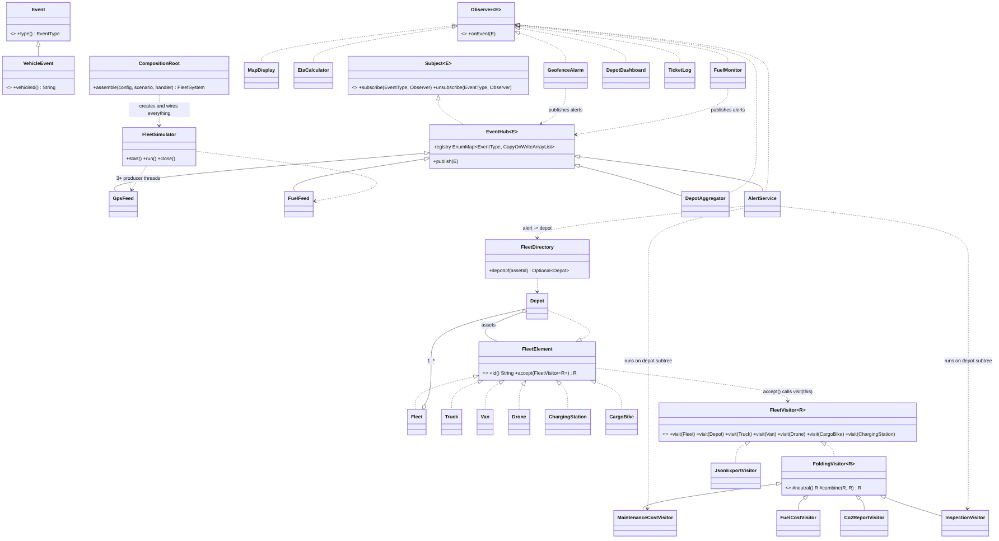
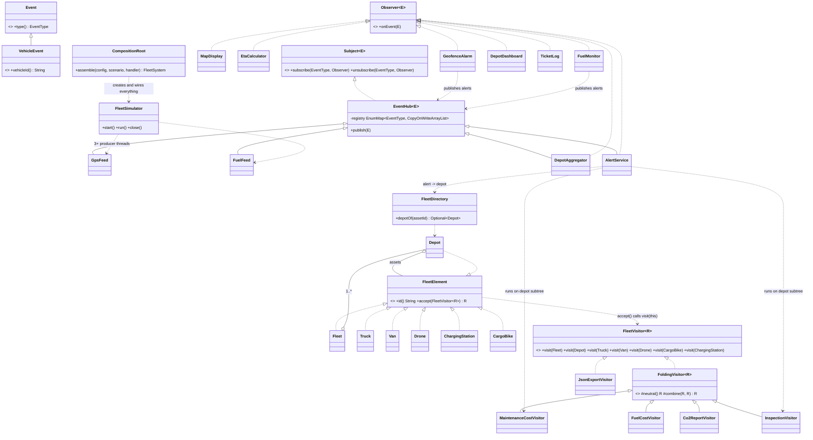

# Fleet Logistics: Observer + Visitor (Assignment 6, Variant 6)

Java 17, JUnit 5, no other libraries. A fleet of trucks, vans, drones and charging stations. Live GPS and fuel data
notifies listeners (**Observer**), and reports are computed over the fleet tree (**Visitor**). An alert
selects one depot and runs a visitor on that subtree only, and the result returns as a maintenance ticket event.

```
mvn test                                   # 65 tests
# run org.example.fleet.Main from the IDE; optional args: [producerThreads=4] [eventsPerProducer=1000] [seed=42]
```

## Architecture

```
GpsFeed ──GPS_POSITION──▶ MapDisplay, EtaCalculator, GeofenceAlarm ─┐ GEOFENCE_ALERT
   │                  └──▶ DepotAggregator ──DEPOT_SUMMARY──▶ DepotDashboard   (observer chain)
FuelFeed ─FUEL_READING──▶ FuelMonitor ────────────────────────────┤ FUEL_ALERT
   │                  └──▶ DepotAggregator                          ▼
                                                  AlertService ── FleetDirectory: vehicle → Depot
                                                       │          depot.accept(InspectionVisitor)
                                                       │          depot.accept(MaintenanceCostVisitor)
                                                       ▼
                                          MAINTENANCE_TICKET ──▶ TicketLog
```

Integration link: **AlertService** (Observer side) calls **InspectionVisitor** and **MaintenanceCostVisitor**
(Visitor side) on the depot of the alerted vehicle only. Alert, inspection, ticket.



The diagram source is `docs/class-diagram.mmd` (Mermaid, rendered below by GitHub).



## Design decisions

### Observer
- **Own generic interfaces**: `Subject<E>`, `Observer<E>`, and `EventHub<E>` as the shared implementation. No `java.util.Observable`, no event-bus library.
- **Push model.** The event carries all the data (`GpsPositionEvent(vehicleId, position, speed)`). Events are immutable records, so they can be handed to many threads without copying or locking. With pull, listeners would call back into the source while other threads change it, which needs locks or inconsistent reads. The cost is that a listener receives fields it may not use. That is cheap for these small events.
- **Per-type subscription**: `subscribe(EventType, observer)`. A fuel listener is never called for GPS events.
- **Registry** (`EventHub`): an `EnumMap` filled with one `CopyOnWriteArrayList` per type *in the constructor* and never changed afterwards. There is no lock on the subject and no lazy initialisation. `publish` iterates over a snapshot, so a listener can join or leave from inside its own handler, or from another thread, while events are in flight. Semantics: an observer removed during a publish may still get the event already in flight, and gets no later one. The copy-on-write cost is paid by subscribe/unsubscribe (rare), not by publish (hot).
- **Failure isolation**: a listener that throws is reported to an injected handler and the others still get the event.
- **Chain**: `DepotAggregator` is an observer of both feeds and a subject (extends `EventHub`) that republishes one `DepotSummaryEvent` every 100 events of a depot. `DepotDashboard` listens to it. It updates per-depot counters with an atomic `compute` on immutable records and publishes *after* `compute` returns, so no map lock is held while foreign code runs. The dashboard keeps the summary with the larger `eventCount`, so out-of-order delivery from two threads cannot show older data.
- Subjects use inheritance (`extends EventHub`) rather than delegation, so each source needs no forwarding methods. `EventHub` has no abstract methods and is never extended to change its behaviour.

### Visitor
- **Tree**: `Fleet → Depot → {Truck, Van, Drone, ChargingStation}` (3 levels, 2 containers, 4 leaves; `CargoBike` is added by the trade-off commit). Elements are immutable records that hold data only. Their only method is `accept`.
- **Double dispatch**: `FleetVisitor<R>` has one `visit` overload per element type. The client holds `FleetElement`, and `visitor.visit(element)` would not compile because overloads are chosen from the *static* type. `element.accept(visitor)` runs inside `Truck`, where `this` is statically a `Truck`, so `visit(Truck)` is chosen. See `DoubleDispatchTest`.
- **Who traverses: the visitor.** Each visitor decides how child results combine (sum, concatenate, nest in JSON) and whether to descend. The containers stay data. The cost is that every visitor must handle containers. The loop is written once in `FoldingVisitor<R>` (`neutral()` + `combine()`), used by four of the five visitors. If traversal lived in the tree, every container would need to know about every kind of result.
- **Visitors**: `MaintenanceCostVisitor` (numeric), `FuelCostVisitor` (numeric), `Co2ReportVisitor` (accumulates state per type across the walk, one instance per traversal), `InspectionVisitor` (filter, returns the overdue elements), `JsonExportVisitor` (hand-written, correctly nested, escaped).
- The stateless visitors are shared between threads by `AlertService`. The stateful one is never shared.

### Concurrency (ch. 13)
- `FleetSimulator` runs `producerThreads` producer tasks on an injected `ExecutorService` (fixed pool, named threads `producer-N`). Default is 4 and it is a program argument. Producer *k* always uses random stream `seed + k`, so runs are reproducible whatever the scheduling.
- Listeners run on the producer thread. All shared state is `ConcurrentHashMap`, `LongAdder`, `ConcurrentLinkedQueue` or immutable records. Nothing locks a whole subject.
- **Shutdown** (`FleetSimulator.close()`): `shutdown()` then `awaitTermination`; only if tasks do not finish in time does it call `shutdownNow()`. Tasks already started publish all their events first, so nothing is lost. `run()` waits on every `Future` and rethrows producer failures.

### Clean Code (ch. 11-12)
- **One composition root**: `CompositionRoot.assemble` is the only place that creates and wires objects. Everything else receives collaborators through constructors. No setters, no singletons, no lazy initialisation, no `new` of services in business code.
- Interfaces exist for a reason: `Subject`/`Observer` (listeners vs sources), `FleetElement`/`FleetVisitor` (the pattern). `FoldingVisitor` removes the repeated child loop. `Consumption` makes fuel cost and CO2 share one litres formula. `FleetDirectory` is the only link from an event to a subtree.
- Known limitations: repeated alerts for one vehicle create repeated tickets (no de-duplication). Events for vehicles unknown to the tree are counted in `DepotAggregator.ignoredEvents()` and ignored by `AlertService`.

## Trade-off proof (two separate changes)

| | Commit | Files changed |
|---|---|---|
| **New visitor** (`FuelCostVisitor`) | commit 1 | **2 new files**: `visitor/FuelCostVisitor.java`, `visitor/FuelCostVisitorTest.java`. **0 existing files, 0 element classes.** |
| **New element type** (`CargoBike`) | commit 2 | **1 new element** `model/CargoBike.java`; **1 interface** `visitor/FleetVisitor.java`; **5 visitors** `MaintenanceCost`, `FuelCost`, `Co2Report`, `Inspection`, `JsonExport`; tests `CargoBikeTest` (new) and `DoubleDispatchTest` (its test visitor must implement the new method). 9 files, 98 insertions. |

**Cost explained.** Visitor makes a new *operation* nearly free: one new class, nothing else is edited. A new *element type* is expensive because the compiler forces every visitor to handle it: the cost is `1 + 1 + V` files, where V is the number of visitors (5 here, and each of them is a place to forget a rule such as "bikes emit zero CO2"). That is the intended trade: the compiler tells you every place that needs a decision.

I would **reject Visitor** if the element types change more often than the operations (for example a catalogue that gains a new vehicle type every sprint) or if there were dozens of visitors, because each new type would then touch dozens of files. Plain polymorphic methods on the elements would be cheaper. Here the tree is stable and reports keep growing, so Visitor fits.

## Tests (65, `mvn test`)
| Area | Tests |
|---|---|
| Observer registry (`EventHubTest`) | per-type delivery, no duplicate subscription, unsubscribe, self-unsubscribe and subscribe inside a handler, failing listener, event immutability, **unsubscribing while 4 threads publish** |
| Visitors | hand-calculated values for maintenance (1506 / 1382 / 2888), fuel cost (3912.8 / 3435.6 / 7348.4), CO2 (12526.9 total; per type and per depot), inspection lists and boundary, exact JSON string, escaping, bracket balance, double dispatch |
| Listeners and chain | map, ETA (111.1949 min for 1° at 60 km/h), geofence border, fuel threshold, aggregator summaries and chain to dashboard, out-of-order summaries |
| Integration | fuel alert in north gives a north-only ticket (cost 1506), geofence alert in south gives a south-only ticket (cost 1382), no ticket when nothing is overdue, unknown vehicle |
| Concurrency | **4 threads × 1,000 events: exactly 4,000 per listener**, whole pipeline counts add up (alerts = inspections = tickets), thread count 1/2/4, same seed gives same result, graceful shutdown with no producer thread left, failing listener under load |

